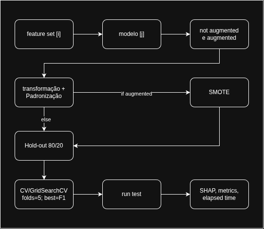
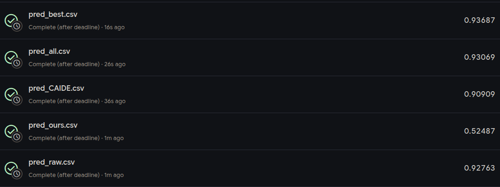

# Projeto Mineração de Dados

Nosso objetivo com este projeto era aplicar indíces de saúde como uma forma de feature engineering em modelos de classificação para a predição de alzheimer, estando os índices presentes em:

- T. T. Vu et al., “Favorable Cardiovascular Health at Young and Middle Ages and Dementia in Older Age—The CHA Study,” Journal of the American Heart Association, vol. 8, no. 1, p. e009730, Jan. 2019, doi: 10.1161/JAHA.118.009730.
- K. Dhana, D. A. Evans, K. B. Rajan, D. A. Bennett, and M. C. Morris, “Healthy lifestyle and the risk of Alzheimer dementia,” Neurology, vol. 95, no. 4, pp. e374–e383, Jul. 2020, doi: 10.1212/WNL.0000000000009816.
- J. A. Pillai et al., “Metabolic syndrome biomarkers relate to rate of cognitive decline in MCI and dementia stages of Alzheimer’s disease,” Alz Res Therapy, vol. 15, no. 1, p. 54, Mar. 2023, doi: 10.1186/s13195-023-01203-y.
- M. Kivipelto, F. Mangialasche, and T. Ngandu, “Lifestyle interventions to prevent cognitive impairment, dementia and Alzheimer disease,” Nat Rev Neurol, vol. 14, no. 11, pp. 653–666, Nov. 2018, doi: 10.1038/s41582-018-0070-3.


Para isso, neste projeto são testados os seguintes modelos de classificação:

- baselines:
    - Decision Tree
    - SVM
    - Logistic Regression
- Bagging: Baseados nos baselines
- Boosting:
    - Baseados nos baselines via AdaBoost
    - XGBoost
- Random Forest
- Stacking:
    - Baseados nos baselines
    - Random Forest
    - Junção de todos os estimadores de stacking anteriores (baselines + Forest)

Aplicamos também diferentes feature sets e balanceamentos, além da busca pelos melhores hiperparâmetros.

O workflow utilizado é o seguinte:



Sendo que cada experimento é executado em paralelo. No total 288 experimentos são feitos.

## Conclusões

Para o dataset utilizado, disponível em [https://www.kaggle.com/competitions/alzheimers-disease-risk-prediction-eu-business/data](https://www.kaggle.com/competitions/alzheimers-disease-risk-prediction-eu-business/data), as features criadas não foram suficientes para a criação de um bom modelo. Contudo, analisando os dados gerados por SHAP, foi possível ver que as features adicionadas apresentaram boa relevância ao modelo. Tal resultado, pode indicar que, em datasets mais vastos, o modelo poderia se aproveitar destas features para melhor desempenho.

Os resultados obtidos na competição do Kaggle são os seguintes para cada conjunto de features:



## Como executar

O código foi feito utilizando um ambiente linux com as seguintes dependências:

- [make](https://www.gnu.org/software/make/)
- [uv](https://docs.astral.sh/uv/getting-started/installation/#standalone-installer)

Para executar o código como esperado, primeiro crie uma token no kaggle, [https://www.kaggle.com/docs/api](https://www.kaggle.com/docs/api), e insira-a no arquivo [key-setup-example.sh](./key-setup-example.sh).
Em seguida, execute:

```bash
uv sync

# para executar o ambiente jupyter com as analises feitas 
# antes e depois da criação dos modelos
make analysis

# para treinar os modelos
make model

# para treinar o modelo com as melhores features
make best

# para extrair as predições para a competição do Kaggle
make comp

# para rodar o dashboard criado
make dashboard 
```

> Vale notar que o dashboard também está disponível através do link: [https://stacking-forest-alzheimer.streamlit.app/](https://stacking-forest-alzheimer.streamlit.app/)

É possível executar este mesmo projeto no Google Colab, se necessário. Basta importar o projeto do github através da url [https://github.com/Dpbm/mestrado-aulas/tree/main/mineracao-de-dados/trabalho/projeto](https://github.com/Dpbm/mestrado-aulas/tree/main/mineracao-de-dados/trabalho/projeto) e dentro dos notebooks exportar a chave do Kaggle logo no início do notebook, como no exemplo abaixo:

```bash
!export KAGGLE_API_TOKEN=<SUA_TOKEN>
```
